<div align="center">


# eenkah

### Your Garmin data, your models, your machine.

Local-first training and recovery analytics: one SQLite file, small models rebuilt from
your own days after every import, and forecasts that must earn their place against your
own baselines. No cloud, no GPU, no account beyond your Garmin one.

[Quick start](#quick-start) · [A look inside](#a-look-inside) · [Privacy](#privacy) · [AI agents (MCP)](#ai-agents-mcp)

[](LICENSE)
[](https://www.rust-lang.org)
[](#privacy)
[](#ai-agents-mcp)

<br>

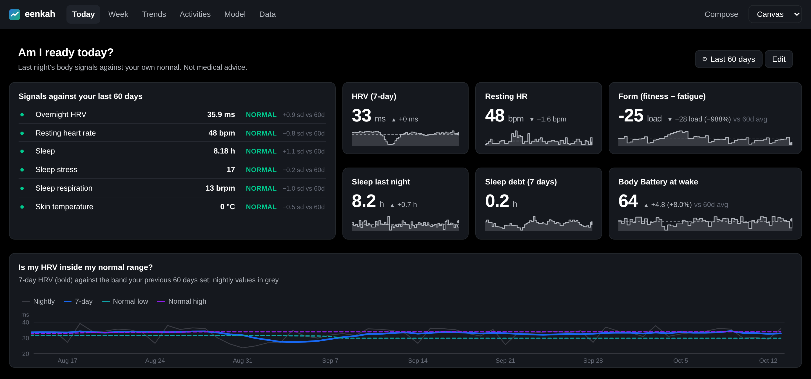

<sub>All screenshots use a synthetic athlete. No real personal data.</sub>

</div>

## Why eenkah

- **Your data stays on your machine.** Everything lives in one SQLite file plus a
  content-addressed archive of the raw Garmin files. The only network calls go to Garmin.
- **Models that learn you, rebuilt on every import.** Tomorrow's HRV and resting heart rate
  are forecast with an 80 % interval. A learned model is used only if it beats every
  personal baseline in a walk-forward backtest, and its track record is always on screen.
- **Your normal, not the population's.** eenkah learns a normal range for each body signal.
  It flags nights that were unusual for you, notices when your normal itself has moved,
  and sorts each session by type.
- **Fast and small.** One Rust binary with the web app built in, CPU only. It imports
  3.7 years of files in 15 s, and every model is rebuilt in about a second.
- **Ask your data from Claude Code.** A built-in MCP server answers questions about your
  training data.
- **Dashboards you can change.** Every view is an editable dashboard, and any chart can be
  rebuilt in the composer.

## A look inside

### Am I ready today?

Last night against your last 60 days, and against the range 8 in 10 of your nights fall in.

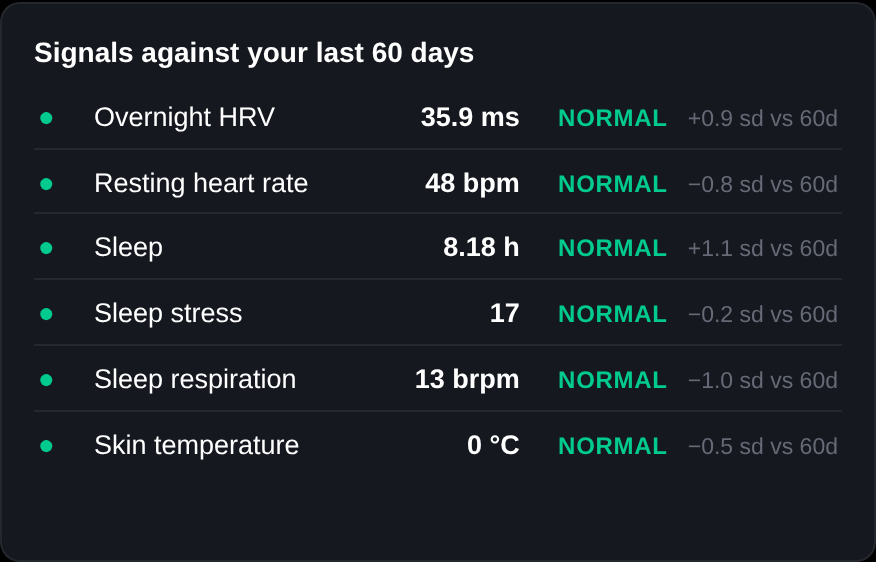

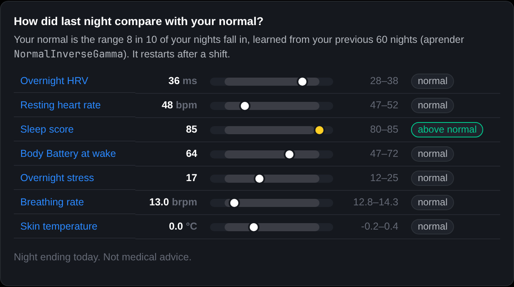

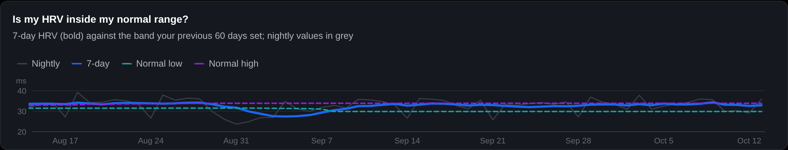

### Has my normal moved?

A drift detector watches each signal and says when a two-week average leaves its old range.

<p align="center">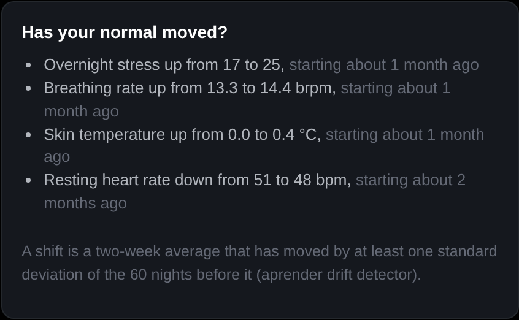</p>

### Should I trust the forecasts?

Every forecast is stored before its outcome is known. Learned models compete with plain
baselines in a walk-forward backtest, and the stated interval is checked against what
happened.

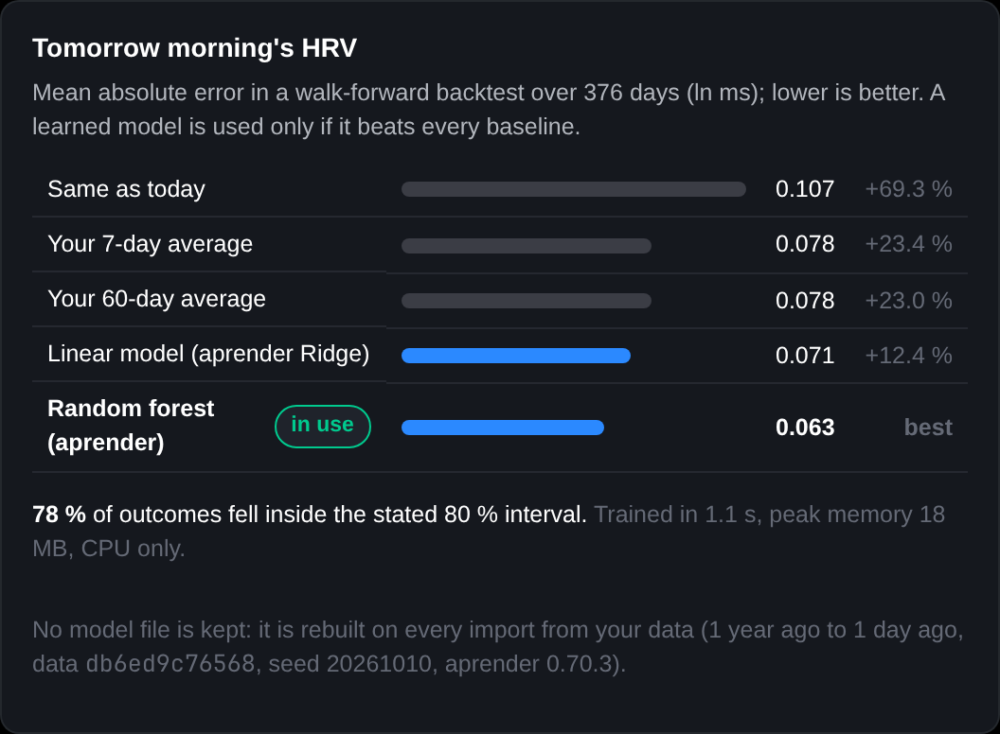

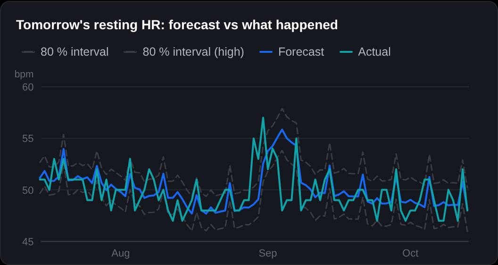

### Where am I heading?

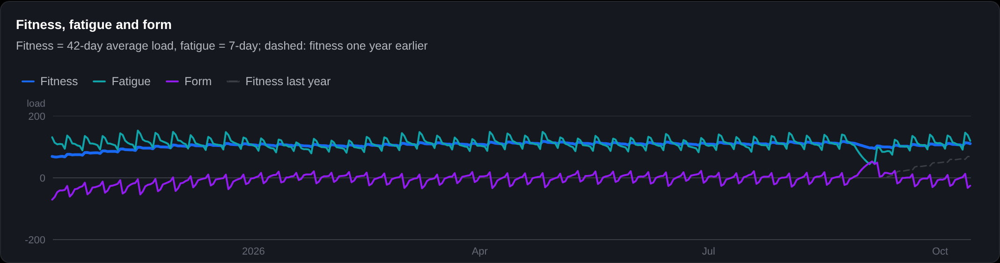

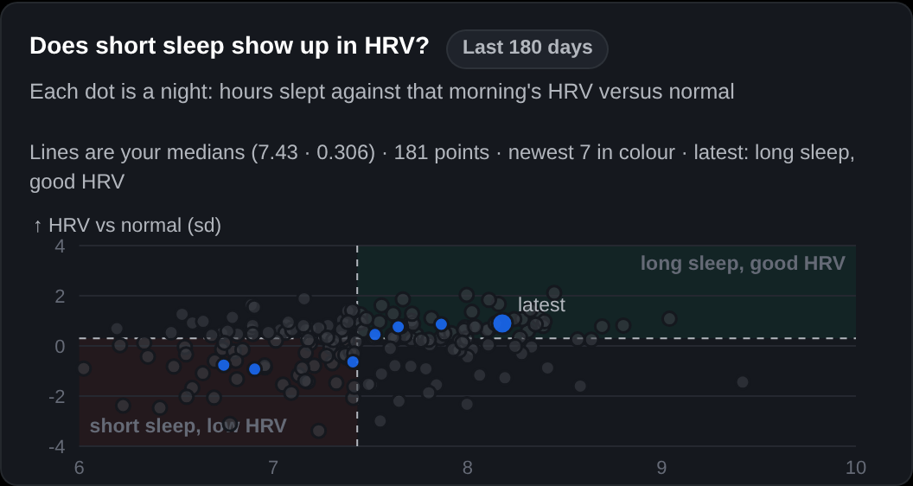

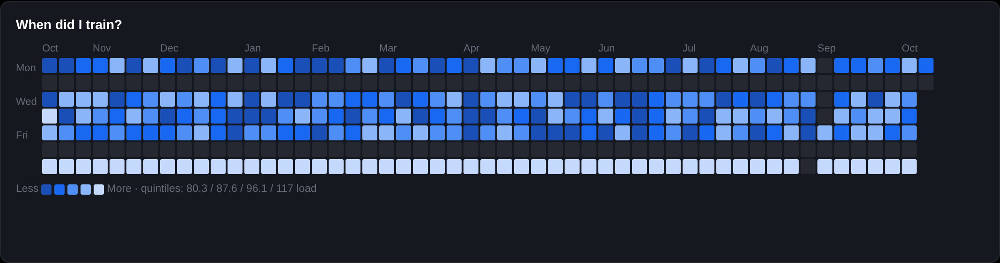

### How is my week going?

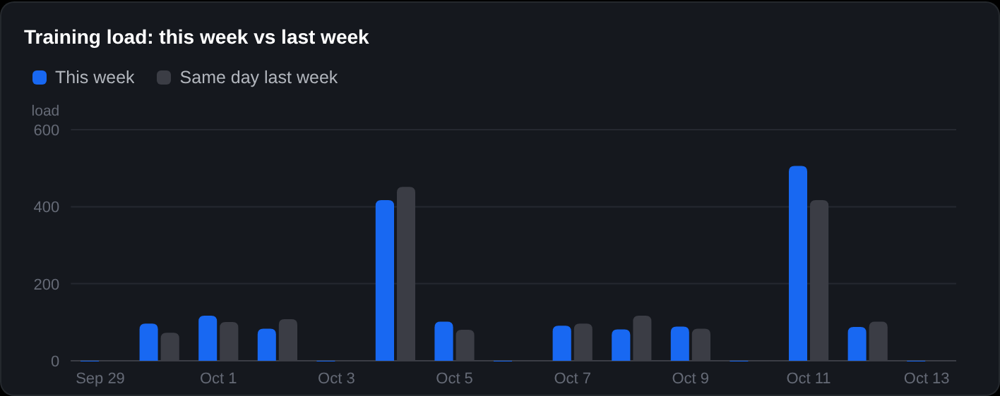

## Quick start

It needs Rust 1.91+ and Node 20+.

```sh
make build             # web app (React + TypeScript) and the release binary, assets embedded
make run               # build, then serve http://127.0.0.1:8090
```

`make` on its own lists every target. `install.sh` is for **production** installs only: it
verifies, builds, installs the binary and, with `--service`, a systemd service plus a daily
import timer (`./install.sh --help`).

## Use

```sh
eenkah login                                        # once: Garmin Connect email, password (used once, never stored), MFA code if asked
eenkah import                                       # download only what is new, then import, compute and forecast
eenkah serve                                        # Today, Week, Trends, Activities, Model, Data
eenkah brief                                        # today in one or two sentences, with the data age
eenkah mark 2026-03-02 sick --through 2026-03-05    # days the watch cannot explain
eenkah threshold lthr 165 --from 2026-01-01         # dated; never rewrites earlier days
eenkah session-type 12345678901 Tempo               # correct a session's type ("clear" to undo)
eenkah model                                        # forecasts, normal ranges, shifts, unusual nights, session types
```

You can also download from the web UI (Data → Download new data). **Retrain now** (Data or
Model page, or `eenkah train`) rebuilds every model from the data already here. Models are
never saved, only their results, in `eenkah.db`, so a restart shows the same forecasts
without retraining.

**Have a Garmin "Export your data" ZIP, or a folder of FIT/JSON files?** `eenkah import <path>`
reads it offline. Later downloads skip everything it already holds.

<details>
<summary><b>How the download stays fast</b></summary>

- Each day is checked against the archive **before** any request.
- There are no fixed sleeps; eenkah backs off only when Garmin answers 429 or 5xx.
- Resting heart rate and weight are fetched as date ranges.
- Hydration is skipped.
- Nothing depends on file times.

A day older than two days is never downloaded twice. A daily run makes about 10 requests.
`--max-requests N` caps a long first backfill; run the import again to continue.

Every file is stored once under its SHA-256 in `raw/`. `eenkah rebuild` recreates the
database from that archive.

</details>

## Privacy

eenkah talks to the network only when you run `eenkah login` or an import from Garmin
Connect. It then contacts Garmin's servers the way the Connect mobile app does: a password
sign-in goes to `sso.garmin.com` and is traded for a renewable OAuth2 token at
`diauth.garmin.com`. Add `-v` (or `-vv`) to any command to see each request; passwords
and tokens are never logged.

Tokens are kept in `<data>/connect/tokens.json`, readable only by you. `eenkah logout`
deletes them. The web server listens on 127.0.0.1 only unless you pass `--listen`.

A data folder holds one Garmin account's data. If you sign in as a different account,
downloads pause until you choose: **Start over** on the Data page (or `eenkah reset`)
replaces the data with the new account's, keeping your sign-in, marked days, thresholds,
settings and dashboards. `eenkah reset --all` leaves the folder as if eenkah had never run.

## AI agents (MCP)

```sh
claude mcp add eenkah -- eenkah mcp
```

Tools: `eenkah_today`, `eenkah_week`, `eenkah_forecast`, `eenkah_normal`, `eenkah_activities`,
`eenkah_activity`, `eenkah_query`, `eenkah_metric_catalog`, and `eenkah_import` (the only
one that writes; with no path it downloads from Garmin Connect).

Connecting an AI client sends the returned health data to that client's model provider.
eenkah itself sends nothing.

## Reproducible claims

Measured on a 2026 laptop with 3.7 years of one athlete's Garmin files (13,944 files):

| | |
|---|---|
| Import | **15 s** |
| Train and walk-forward backtest both forecasts | **10 s** |
| Daily Connect download | about **10 requests** |

`eenkah import <folder>`, `eenkah train` and `eenkah import` print their timings, so you
can check these on your own data.

## Layout

| Path | Job |
|---|---|
| `crates/eenkah-core` | Metric formulas, features, findings. Pure functions |
| `crates/eenkah-ingest` | Garmin JSON and FIT → typed records |
| `crates/eenkah-connect` | Garmin Connect sign-in and incremental download |
| `crates/eenkah-store` | `eenkah.db`, `raw/` archive, import, rebuild, derived series |
| `crates/eenkah-learn` | aprender models rebuilt on every run: forecasts (walk-forward backtest, promotion), normal ranges, shifts, unusual nights, session types |
| `crates/eenkah-api` | HTTP API, import job, embedded web app; suyo mounted at `/suyo` |
| `crates/eenkah-mcp` | MCP tools (pmcp) over the same calls |
| `crates/eenkah-cli` | The `eenkah` binary |
| `crates/eenkah-testkit` | Synthetic athlete; no real personal data in fixtures. `--example demo` writes the screenshot data |
| `crates/suyo` | suyo, the charting library and server, vendored here until it has its own repository |
| `ui/` | The web app: React + TypeScript (strict), charts from suyo's React library |
| `dashboards/` | Default views as editable suyo dashboard JSON |

Development:

- `make dev` runs the API plus Vite with hot reload on :5173.
- `make test` runs the Rust tests and the TypeScript type checks.
- `make verify` runs everything CI checks: format, clippy, tests and type checks.

See `docs/METRICS.md`, `docs/DATA.md` and `docs/DOGFOOD.md`.

## Licence

MIT. See [LICENSE](LICENSE).

**Not medical advice.** Not affiliated with Garmin.
